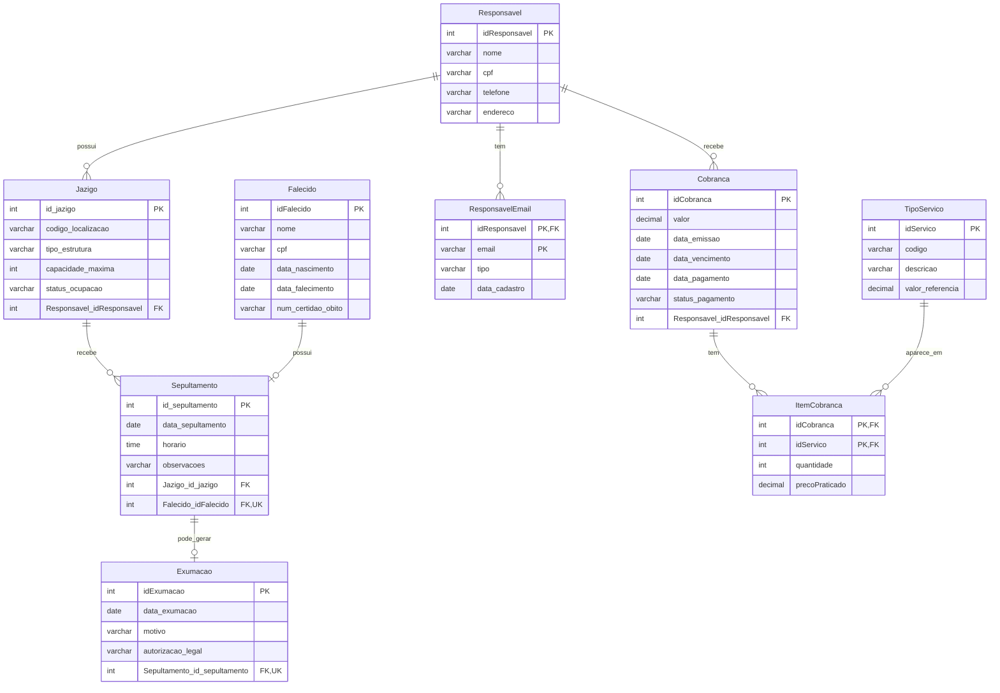

# Modelo do banco de dados - Sistema de Cemitério

Atualizei esta parte para deixar os relacionamentos de acordo com o minimundo e o script-ddl.sql.

## 1. Tabelas do projeto

- **Responsavel:** nome, CPF e contato de quem cuida dos jazigos e recebe cobrancas.
- **Jazigo:** local, tipo de estrutura, capacidade e responsavel.
- **Falecido:** dados da pessoa e numero da certidao de obito.
- **Sepultamento:** data, horario e ligacao com o jazigo e o falecido.
- **Exumacao:** dados da exumacao e sepultamento ao qual ela pertence.
- **Cobranca:** valor, data de emissão, vencimento, pagamento, situação e responsável.
- **ResponsavelEmail:** guarda os emails de cada responsável, o tipo e a data de cadastro.
- **TipoServico:** lista os servicos que podem entrar em uma cobranca.
- **ItemCobranca:** junta cobrancas e servicos e guarda quantidade e preco.

## 2. Diagrama com os relacionamentos

O diagrama mostra as entidades, seus atributos e as cardinalidades. Coloquei as chaves para facilitar a comparação com o modelo relacional.

## 3. Como ficaram os relacionamentos

| Relacao | Tipo | Como foi feita |
| --- | --- | --- |
| Responsavel - Jazigo | 1:N | FK do responsavel em Jazigo |
| Responsavel - Cobranca | 1:N | FK do responsavel em Cobranca |
| Responsavel - ResponsavelEmail | 1:N | FK do responsavel na tabela de emails |
| Jazigo - Sepultamento | 1:N | FK do jazigo em Sepultamento |
| Falecido - Sepultamento | 1:1 | FK unica do falecido em Sepultamento |
| Sepultamento - Exumacao | 1:1 (opcional) | FK unica do sepultamento em Exumacao |
| Cobranca - TipoServico | N:N | ItemCobranca, com duas FKs e chave composta |

## 4. Algumas observacoes

- Um mesmo servico pode aparecer em varias cobrancas, e uma cobranca pode ter varios servicos. Foi por isso que usamos a tabela **ItemCobranca**.
- No 1:1, usei **UNIQUE** nas FKs para nao permitir mais de um sepultamento por falecido nem mais de uma exumacao por sepultamento. Um falecido cadastrado ainda pode nao ter sepultamento, e um sepultamento pode nao ter exumacao.
- A certidao de obito foi colocada como obrigatoria em Falecido.
- O banco tem as chaves para garantir as ligacoes entre as tabelas. A verificacao de vagas no jazigo e do prazo de exumacao ainda depende da logica do sistema.

O arquivo `cemiterio.mwb` e a imagem `cemiterio.drawio.png` foram mantidos como registros da modelagem anterior. **Para esta atividade, este diagrama, o [modelo relacional](modelo-relacional.md) e o [script-ddl.sql](script-ddl.sql) são a referência.**

O campo tipo e a data de cadastro foram acrescentados em ResponsavelEmail. A data de emissão foi acrescentada em Cobranca para organizar a sequência dos atendimentos. As cardinalidades anteriores foram mantidas.
